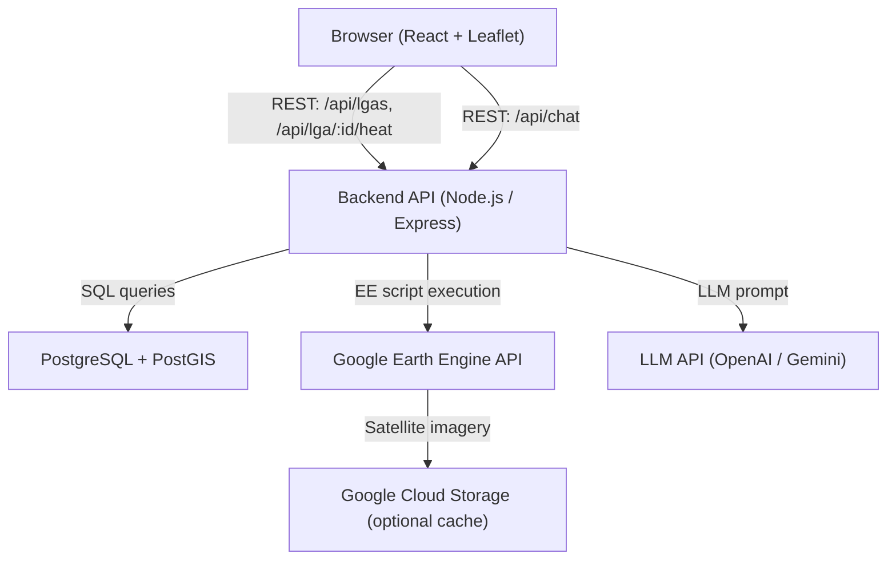
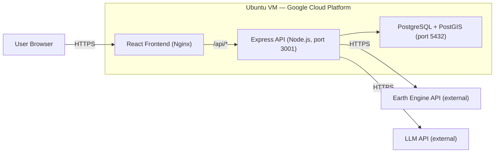
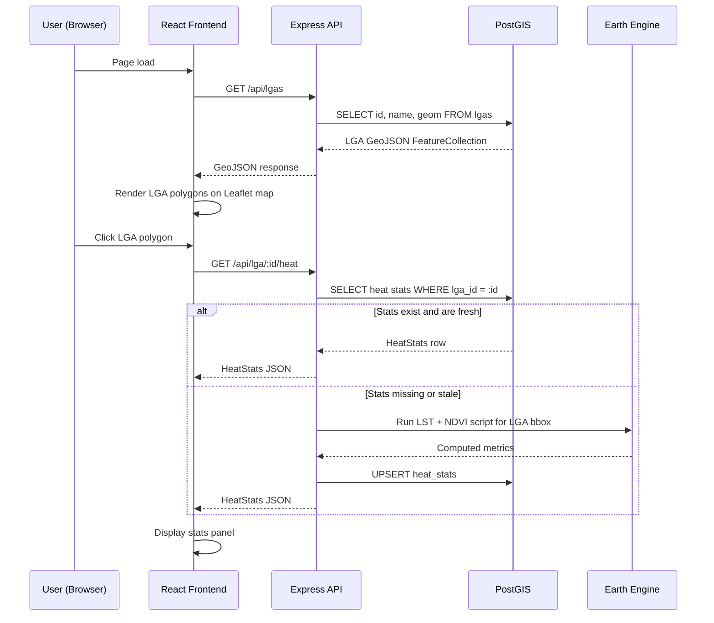
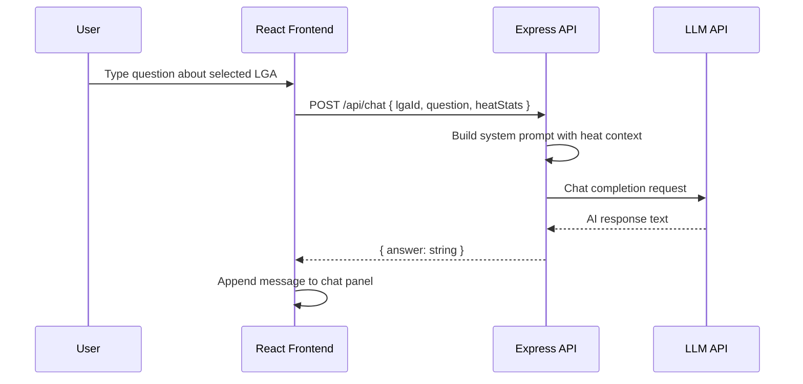
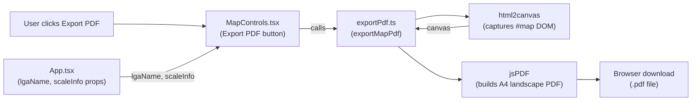
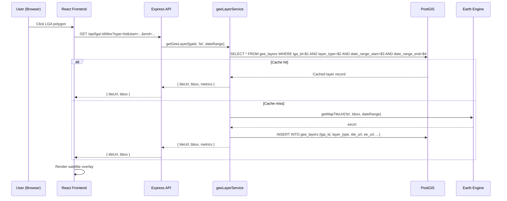

# Design Document: HeatGPT

## Overview

HeatGPT is a cloud-based GIS web application that enables users to explore Urban Heat Islands (UHI)
across Australian Local Government Areas (LGAs). Users interact with an interactive map, click on
any LGA to retrieve heat analysis statistics (land surface temperature, NDVI, heat island intensity),
and engage with an AI chat interface — HeatGPT — that explains the heat patterns in plain language.

The system follows a SatGPT/FloodGPT-style UX: a full-screen map with a slide-in panel for data
and chat. Processing is driven by Google Earth Engine for satellite-derived metrics, stored in
PostGIS, and served via a Node.js/Express REST API.

The application is hosted on an Ubuntu VM on Google Cloud Platform and built incrementally:
map + LGA boundaries first, then Earth Engine integration, then the chat interface.


---

## Architecture

### System Overview



### Deployment Topology




---

## Sequence Diagrams

### LGA Selection and Heat Data Flow



### HeatGPT Chat Flow




---


---

## Components and Interfaces

### Frontend Components

#### MapView

**Purpose**: Full-screen Leaflet map rendering LGA boundaries and heat choropleth.

**Interface**:
```typescript
interface MapViewProps {
  onLgaSelect: (lgaId: string) => void
}

// Leaflet layer config
interface LgaFeature extends GeoJSON.Feature {
  properties: {
    lga_id: string
    lga_name: string
    state: string
  }
}
```

**Responsibilities**:
- Load and render LGA GeoJSON polygons
- Apply heat choropleth colouring based on LST values
- Emit `onLgaSelect` when user clicks a polygon
- Fit map bounds to Australia on initial load

#### SidePanel

**Purpose**: Slide-in panel showing LGA heat statistics and the HeatGPT chat interface.

**Interface**:
```typescript
interface SidePanelProps {
  lgaId: string | null
  heatStats: HeatStats | null
  loading: boolean
}
```

**Responsibilities**:
- Display selected LGA name and heat metrics
- Render metric cards (LST, NDVI, UHI intensity)
- Host the ChatInterface component
- Show skeleton loaders while data is fetching

#### ChatInterface

**Purpose**: Conversational interface for HeatGPT explanations.

**Interface**:
```typescript
interface ChatMessage {
  role: 'user' | 'assistant'
  content: string
  timestamp: Date
}

interface ChatInterfaceProps {
  lgaId: string
  heatStats: HeatStats
}
```

**Responsibilities**:
- Maintain local message history
- Send user questions with heat context to `/api/chat`
- Stream or display AI responses
- Provide suggested prompt chips (e.g. "Why is this area hot?")

### Backend Services

#### LgaService

**Purpose**: Retrieve LGA boundary data from PostGIS.

**Interface**:
```typescript
interface LgaService {
  getAllLgas(): Promise<GeoJSON.FeatureCollection>
  getLgaById(lgaId: string): Promise<LgaRecord | null>
}
```

#### HeatService

**Purpose**: Retrieve or compute heat statistics for an LGA.

**Interface**:
```typescript
interface HeatService {
  getHeatStats(lgaId: string): Promise<HeatStats>
  computeAndStore(lgaId: string, bbox: BBox): Promise<HeatStats>
  isStale(processedAt: Date, maxAgeDays?: number): boolean
}
```

#### EarthEngineService

**Purpose**: Execute Earth Engine scripts and return computed metrics.

**Interface**:
```typescript
interface EarthEngineService {
  computeLST(bbox: BBox, dateRange: DateRange): Promise<number>
  computeNDVI(bbox: BBox, dateRange: DateRange): Promise<number>
  computeUHI(lgaLST: number, regionMeanLST: number): number
}
```

#### ChatService

**Purpose**: Build prompts and call the LLM API.

**Interface**:
```typescript
interface ChatService {
  buildSystemPrompt(heatStats: HeatStats, lgaName: string): string
  sendMessage(messages: ChatMessage[], systemPrompt: string): Promise<string>
}
```

#### ImportService

**Purpose**: Import ABS LGA Shapefile data into the PostGIS `lgas` table.

**Interface**:
```typescript
interface ImportResult {
  inserted: number
  updated: number
  repaired: number
  errors: string[]
}

interface ImportService {
  importShapefile(shpPath: string): Promise<ImportResult>
}
```


---

## Data Models

### PostgreSQL / PostGIS Schema

#### Table: `lgas`

```sql
CREATE TABLE lgas (
    lga_id      VARCHAR(10)  PRIMARY KEY,   -- ABS LGA code
    lga_name    VARCHAR(255) NOT NULL,
    state       VARCHAR(50)  NOT NULL,
    geom        GEOMETRY(MultiPolygon, 4326) NOT NULL,
    bbox        JSONB,                       -- {west, south, east, north}
    area_km2    NUMERIC(12, 4),
    created_at  TIMESTAMPTZ  DEFAULT NOW()
);

CREATE INDEX idx_lgas_geom ON lgas USING GIST(geom);
```

#### Table: `heat_stats`

```sql
CREATE TABLE heat_stats (
    id              SERIAL PRIMARY KEY,
    lga_id          VARCHAR(10) NOT NULL REFERENCES lgas(lga_id),
    avg_lst_celsius NUMERIC(6, 3),           -- Average Land Surface Temperature
    avg_ndvi        NUMERIC(6, 4),           -- NDVI (-1 to 1)
    uhi_intensity   NUMERIC(6, 3),           -- LST delta vs regional mean (°C)
    data_source     VARCHAR(50),             -- e.g. 'landsat8', 'landsat9'
    date_range_start DATE,
    date_range_end   DATE,
    processed_at    TIMESTAMPTZ DEFAULT NOW(),
    UNIQUE(lga_id)
);

CREATE INDEX idx_heat_stats_lga ON heat_stats(lga_id);
```

### TypeScript Types

```typescript
interface HeatStats {
  lgaId: string
  lgaName: string
  avgLstCelsius: number       // Average land surface temperature
  avgNdvi: number             // NDVI index (-1 to 1)
  uhiIntensity: number        // Delta vs regional mean (°C)
  dataSource: string
  dateRangeStart: string      // ISO date
  dateRangeEnd: string        // ISO date
  processedAt: string         // ISO datetime
}

interface LgaRecord {
  lgaId: string
  lgaName: string
  state: string
  bbox: BBox
  areaKm2: number
}

interface BBox {
  west: number
  south: number
  east: number
  north: number
}

interface DateRange {
  start: string   // 'YYYY-MM-DD'
  end: string     // 'YYYY-MM-DD'
}
```


---

## Algorithmic Pseudocode

### Algorithm 1: Get Heat Stats (with staleness check)

```pascal
ALGORITHM getHeatStats(lgaId)
INPUT:  lgaId: string
OUTPUT: heatStats: HeatStats

BEGIN
  ASSERT lgaId IS NOT NULL AND lgaId IS NOT EMPTY

  cached ← database.query(
    "SELECT * FROM heat_stats WHERE lga_id = $1", [lgaId]
  )

  IF cached IS NOT NULL AND NOT isStale(cached.processed_at, maxAgeDays=7) THEN
    RETURN mapRowToHeatStats(cached)
  END IF

  lga ← database.query("SELECT * FROM lgas WHERE lga_id = $1", [lgaId])

  IF lga IS NULL THEN
    RAISE Error("LGA not found: " + lgaId)
  END IF

  metrics ← computeEarthEngineMetrics(lga.bbox, defaultDateRange())

  UPSERT heat_stats SET
    avg_lst_celsius = metrics.lst,
    avg_ndvi        = metrics.ndvi,
    uhi_intensity   = metrics.uhi,
    processed_at    = NOW()
  WHERE lga_id = lgaId

  RETURN buildHeatStats(lga, metrics)
END
```

**Preconditions:**
- `lgaId` is a valid non-empty string
- Database connection is available
- Earth Engine credentials are initialised

**Postconditions:**
- Returns a fully populated `HeatStats` object
- `heat_stats` row is created or updated in the database
- `processedAt` reflects the current computation time

**Loop Invariants:** N/A (no loops in this algorithm)

---

### Algorithm 2: Compute Earth Engine Metrics

```pascal
ALGORITHM computeEarthEngineMetrics(bbox, dateRange)
INPUT:  bbox: BBox, dateRange: DateRange
OUTPUT: metrics: { lst: number, ndvi: number, uhi: number }

BEGIN
  ASSERT bbox.west < bbox.east
  ASSERT bbox.south < bbox.north
  ASSERT dateRange.start < dateRange.end

  region ← ee.Geometry.Rectangle([bbox.west, bbox.south, bbox.east, bbox.north])

  // Land Surface Temperature from Landsat thermal band
  landsatCollection ← ee.ImageCollection("LANDSAT/LC09/C02/T1_L2")
    .filterBounds(region)
    .filterDate(dateRange.start, dateRange.end)
    .filter(ee.Filter.lt("CLOUD_COVER", 20))

  IF landsatCollection.size() = 0 THEN
    RAISE Error("No Landsat imagery available for date range")
  END IF

  lstImage ← landsatCollection
    .select("ST_B10")
    .mean()
    .multiply(0.00341802)
    .add(149.0)
    .subtract(273.15)   // Convert Kelvin to Celsius

  lst ← lstImage.reduceRegion(ee.Reducer.mean(), region, scale=30)
               .get("ST_B10")

  // NDVI from Sentinel-2
  s2Collection ← ee.ImageCollection("COPERNICUS/S2_SR_HARMONIZED")
    .filterBounds(region)
    .filterDate(dateRange.start, dateRange.end)
    .filter(ee.Filter.lt("CLOUDY_PIXEL_PERCENTAGE", 20))

  ndviImage ← s2Collection.median()
    .normalizedDifference(["B8", "B4"])

  ndvi ← ndviImage.reduceRegion(ee.Reducer.mean(), region, scale=10)
                  .get("nd")

  // UHI intensity: LGA LST minus regional mean LST
  australiaBbox ← ee.Geometry.Rectangle([113.0, -44.0, 154.0, -10.0])
  regionalLST ← lstImage.reduceRegion(ee.Reducer.mean(), australiaBbox, scale=1000)
                        .get("ST_B10")
  uhi ← lst - regionalLST

  ASSERT lst IS NOT NULL
  ASSERT ndvi >= -1 AND ndvi <= 1

  RETURN { lst: lst, ndvi: ndvi, uhi: uhi }
END
```

**Preconditions:**
- `bbox` defines a valid geographic rectangle within Australia
- `dateRange` spans at least 30 days to ensure imagery availability
- Earth Engine is authenticated and initialised
- Cloud cover filter threshold is between 0 and 100

**Postconditions:**
- `lst` is a numeric value in degrees Celsius
- `ndvi` is in the range [-1, 1]
- `uhi` is the temperature delta (positive = warmer than regional mean)
- No mutations to input parameters

**Loop Invariants:** N/A (Earth Engine operations are declarative)

---

### Algorithm 3: Build HeatGPT Chat Prompt

```pascal
ALGORITHM buildSystemPrompt(heatStats, lgaName)
INPUT:  heatStats: HeatStats, lgaName: string
OUTPUT: systemPrompt: string

BEGIN
  ASSERT heatStats IS NOT NULL
  ASSERT lgaName IS NOT EMPTY

  uhiDescription ← CASE
    WHEN heatStats.uhiIntensity > 3.0  THEN "severe urban heat island"
    WHEN heatStats.uhiIntensity > 1.5  THEN "moderate urban heat island"
    WHEN heatStats.uhiIntensity > 0.0  THEN "mild urban heat island"
    ELSE                                    "no significant heat island effect"
  END CASE

  vegetationDescription ← CASE
    WHEN heatStats.avgNdvi > 0.5  THEN "dense vegetation"
    WHEN heatStats.avgNdvi > 0.3  THEN "moderate vegetation"
    WHEN heatStats.avgNdvi > 0.1  THEN "sparse vegetation"
    ELSE                               "minimal vegetation or urban surface"
  END CASE

  systemPrompt ← FORMAT(
    "You are HeatGPT, an expert in urban heat islands and climate science. " +
    "The user is exploring {lgaName} in Australia. " +
    "Key data: Average LST = {lst}°C, NDVI = {ndvi} ({vegDesc}), " +
    "UHI Intensity = {uhi}°C ({uhiDesc}). " +
    "Data period: {start} to {end}. " +
    "Answer questions clearly and suggest mitigation strategies where relevant.",
    lgaName, heatStats.avgLstCelsius, heatStats.avgNdvi, vegetationDescription,
    heatStats.uhiIntensity, uhiDescription,
    heatStats.dateRangeStart, heatStats.dateRangeEnd
  )

  ASSERT systemPrompt IS NOT EMPTY
  RETURN systemPrompt
END
```

**Preconditions:**
- `heatStats` contains valid numeric values for all fields
- `lgaName` is a non-empty string

**Postconditions:**
- Returns a non-empty string suitable as an LLM system prompt
- Prompt includes all relevant heat metrics and contextual descriptions
- No side effects


---

## Key Functions with Formal Specifications

### `GET /api/lgas` — Express Route Handler

```typescript
// Returns all LGA boundaries as GeoJSON FeatureCollection
async function getLgas(req: Request, res: Response): Promise<void>
```

**Preconditions:**
- Database connection pool is initialised
- `lgas` table contains at least one row with valid geometry

**Postconditions:**
- Returns HTTP 200 with `GeoJSON.FeatureCollection` body
- Each feature contains `lga_id`, `lga_name`, `state` in properties
- Returns HTTP 500 with error message on database failure

---

### `GET /api/lga/:id/heat` — Express Route Handler

```typescript
async function getLgaHeat(req: Request, res: Response): Promise<void>
```

**Preconditions:**
- `req.params.id` is a non-empty string
- LGA with that ID exists in the database

**Postconditions:**
- Returns HTTP 200 with `HeatStats` JSON body
- If stats are stale (> 7 days), triggers recomputation before responding
- Returns HTTP 404 if LGA ID does not exist
- Returns HTTP 500 on Earth Engine or database failure

---

### `POST /api/chat` — Express Route Handler

```typescript
interface ChatRequest {
  lgaId: string
  question: string
  heatStats: HeatStats
  history?: ChatMessage[]
}

async function postChat(req: Request, res: Response): Promise<void>
```

**Preconditions:**
- `req.body.lgaId` is a valid LGA ID
- `req.body.question` is a non-empty string (max 500 chars)
- `req.body.heatStats` is a valid `HeatStats` object

**Postconditions:**
- Returns HTTP 200 with `{ answer: string }` body
- Answer is contextualised to the provided heat statistics
- Returns HTTP 400 if required fields are missing
- Returns HTTP 500 on LLM API failure

---

### `isStale(processedAt, maxAgeDays)` — HeatService

```typescript
function isStale(processedAt: Date, maxAgeDays: number = 7): boolean
```

**Preconditions:**
- `processedAt` is a valid Date object
- `maxAgeDays` is a positive integer

**Postconditions:**
- Returns `true` if `(now - processedAt) > maxAgeDays * 86400000`
- Returns `false` otherwise
- No side effects

---

### `computeUHI(lgaLST, regionMeanLST)` — EarthEngineService

```typescript
function computeUHI(lgaLST: number, regionMeanLST: number): number
```

**Preconditions:**
- Both arguments are finite numbers in degrees Celsius
- `regionMeanLST` is computed from a representative regional area

**Postconditions:**
- Returns `lgaLST - regionMeanLST`
- Positive result indicates urban heat island effect
- No side effects


---

## Example Usage

### Frontend: Loading LGAs and Handling Selection

```typescript
// MapView.tsx
useEffect(() => {
  fetch('/api/lgas')
    .then(res => res.json())
    .then((geojson: GeoJSON.FeatureCollection) => {
      L.geoJSON(geojson, {
        style: feature => heatChoropleth(feature?.properties?.avg_lst),
        onEachFeature: (feature, layer) => {
          layer.on('click', () => onLgaSelect(feature.properties.lga_id))
        }
      }).addTo(map)
    })
}, [])
```

### Frontend: Fetching Heat Stats on LGA Click

```typescript
// App.tsx
const handleLgaSelect = async (lgaId: string) => {
  setLoading(true)
  const res = await fetch(`/api/lga/${lgaId}/heat`)
  const stats: HeatStats = await res.json()
  setSelectedStats(stats)
  setLoading(false)
}
```

### Frontend: Sending a Chat Message

```typescript
// ChatInterface.tsx
const sendMessage = async (question: string) => {
  const res = await fetch('/api/chat', {
    method: 'POST',
    headers: { 'Content-Type': 'application/json' },
    body: JSON.stringify({ lgaId, question, heatStats, history: messages })
  })
  const { answer } = await res.json()
  setMessages(prev => [...prev, { role: 'assistant', content: answer, timestamp: new Date() }])
}
```

### Backend: Express Route Registration

```typescript
// routes/lga.ts
router.get('/lgas', getLgas)
router.get('/lga/:id/heat', getLgaHeat)
router.post('/chat', postChat)
```

### Backend: Earth Engine Initialisation

```typescript
// services/earthEngine.ts
import ee from '@google/earthengine'

export async function initEarthEngine(): Promise<void> {
  const key = JSON.parse(fs.readFileSync(process.env.EE_KEY_FILE!, 'utf8'))
  await new Promise<void>((resolve, reject) => {
    ee.data.authenticateViaPrivateKey(key, () => {
      ee.initialize(null, null, resolve, reject)
    })
  })
}
```


---

## LGA Shapefile Import Pipeline

### Overview

The ABS LGA boundary dataset is distributed as an ESRI Shapefile (`.shp` + `.dbf` + `.shx` + `.prj`). The import pipeline converts this into PostGIS rows in the `lgas` table, reprojects coordinates to WGS84, maps ABS attribute fields to schema columns, and computes derived columns (`bbox`, `area_km2`).

### Import Flow

```
.shp file
    │
    ▼
shp2pgsql (reproject + generate SQL)
    │
    ▼
psql (execute SQL against PostGIS)
    │
    ▼
lgas table (raw geometry loaded)
    │
    ▼
Post-processing SQL:
  - Populate bbox from ST_Envelope components
  - Populate area_km2 from ST_Area(geom::geography)
  - Validate with ST_IsValid; repair with ST_MakeValid
```

### shp2pgsql Command

```bash
# For GDA2020 source (EPSG:7844 → EPSG:4326)
shp2pgsql -s 7844:4326 -I -u /path/to/LGA_2022_AUST_GDA2020.shp lgas_staging | psql -U postgres -d heatgpt

# For GDA94 source (EPSG:4283 → EPSG:4326)
shp2pgsql -s 4283:4326 -I -u /path/to/LGA_2022_AUST_GDA94.shp lgas_staging | psql -U postgres -d heatgpt
```

**Flag reference:**
- `-s <src>:4326` — reproject from source CRS to WGS84
- `-I` — create a GIST spatial index on the geometry column
- `-u` — upsert mode (generates `INSERT ... ON CONFLICT DO UPDATE`)

### Field Mapping

| Shapefile attribute | `lgas` column |
|---------------------|---------------|
| `LGA_CODE22`        | `lga_id`      |
| `LGA_NAME22`        | `lga_name`    |
| `STE_NAME21`        | `state`       |
| *(geometry)*        | `geom`        |

### Post-Processing SQL

After `shp2pgsql` loads the raw geometry, run the following to populate derived columns and validate geometries:

```sql
-- Repair invalid geometries
UPDATE lgas
SET geom = ST_MakeValid(geom)
WHERE NOT ST_IsValid(geom);

-- Populate bbox
UPDATE lgas
SET bbox = jsonb_build_object(
    'west',  ST_XMin(geom::geometry),
    'south', ST_YMin(geom::geometry),
    'east',  ST_XMax(geom::geometry),
    'north', ST_YMax(geom::geometry)
)
WHERE bbox IS NULL;

-- Populate area_km2
UPDATE lgas
SET area_km2 = ST_Area(geom::geography) / 1000000
WHERE area_km2 IS NULL;
```

### Node.js Import Script Interface

The import pipeline is exposed as both a standalone script and an admin API endpoint.

**Standalone script** (`scripts/import-lga.js`):
```bash
node scripts/import-lga.js --shp /path/to/LGA_2022_AUST_GDA2020.shp --epsg 7844
```

**Admin endpoint**: `POST /api/admin/import-lgas`
- Accepts a multipart upload (`shp`, `dbf`, `shx`, `prj` fields) or a `{ "shpPath": string }` JSON body
- Returns `{ inserted, updated, repaired, errors }` on success

**TypeScript interface**:
```typescript
async function importShapefile(shpPath: string): Promise<ImportResult>
// 1. Detect source EPSG from .prj file (7844 or 4283)
// 2. Run: shp2pgsql -s <epsg>:4326 -I -u <shpPath> lgas | psql ...
// 3. Run post-processing SQL (bbox, area_km2, ST_MakeValid)
// 4. Return ImportResult with counts
```

---

## Correctness Properties

*A property is a characteristic or behavior that should hold true across all valid executions of a system — essentially, a formal statement about what the system should do. Properties serve as the bridge between human-readable specifications and machine-verifiable correctness guarantees.*

### Property 1: Heat stats response shape and value ranges

*For any* valid LGA ID in the database, `GET /api/lga/:id/heat` returns HTTP 200 with a `HeatStats` body containing all required fields (`avgLstCelsius`, `avgNdvi`, `uhiIntensity`, `dataSource`, `dateRangeStart`, `dateRangeEnd`, `processedAt`), where `avgNdvi` is in [-1, 1] and `avgLstCelsius` is in [-10, 70].

**Validates: Requirements 3.1, 3.2, 5.7**

---

### Property 2: LGA GeoJSON feature completeness

*For any* LGA GeoJSON feature returned by `GET /api/lgas`, the feature has `lga_id`, `lga_name`, and `state` as properties, and a valid `geometry` of type `MultiPolygon` or `Polygon`.

**Validates: Requirements 2.1, 2.2, 2.3**

---

### Property 3: UHI is the arithmetic difference

*For any* two finite numeric values `lgaLST` and `regionMeanLST` in degrees Celsius, `computeUHI(lgaLST, regionMeanLST)` returns exactly `lgaLST - regionMeanLST` with no side effects and no mutation of inputs.

**Validates: Requirements 5.3, 6.1, 6.3**

---

### Property 4: isStale correctness

*For any* `processedAt` date and positive integer `maxAgeDays`, `isStale(processedAt, maxAgeDays)` returns `true` if and only if the elapsed time since `processedAt` exceeds `maxAgeDays × 86400000` milliseconds, and produces no side effects.

**Validates: Requirements 4.1, 4.2, 4.4**

---

### Property 5: Cache hit avoids Earth Engine

*For any* LGA ID whose `heat_stats` record exists in PostGIS and is not stale, `HeatService.getHeatStats` returns the cached record without invoking the EarthEngineService.

**Validates: Requirements 3.3**

---

### Property 6: Cache miss triggers recomputation and upsert

*For any* LGA ID whose `heat_stats` record is absent or stale, `HeatService.getHeatStats` invokes the EarthEngineService and upserts the resulting metrics into `heat_stats` before returning.

**Validates: Requirements 3.4**

---

### Property 7: buildSystemPrompt is pure and complete

*For any* valid `HeatStats` object and non-empty `lgaName`, `buildSystemPrompt(heatStats, lgaName)` returns a non-empty string that includes the LGA name, `avgLstCelsius`, `avgNdvi`, `uhiIntensity`, `dateRangeStart`, and `dateRangeEnd`; and calling it twice with the same arguments always returns the same string.

**Validates: Requirements 10.1, 10.10**

---

### Property 8: UHI description thresholds

*For any* `HeatStats` object, `buildSystemPrompt` includes exactly the correct UHI description: "severe urban heat island" when `uhiIntensity > 3.0`, "moderate urban heat island" when `1.5 < uhiIntensity ≤ 3.0`, "mild urban heat island" when `0.0 < uhiIntensity ≤ 1.5`, and "no significant heat island effect" when `uhiIntensity ≤ 0.0`.

**Validates: Requirements 10.2, 10.3, 10.4, 10.5**

---

### Property 9: Vegetation description thresholds

*For any* `HeatStats` object, `buildSystemPrompt` includes exactly the correct vegetation description: "dense vegetation" when `avgNdvi > 0.5`, "moderate vegetation" when `0.3 < avgNdvi ≤ 0.5`, "sparse vegetation" when `0.1 < avgNdvi ≤ 0.3`, and "minimal vegetation or urban surface" when `avgNdvi ≤ 0.1`.

**Validates: Requirements 10.6, 10.7, 10.8, 10.9**

---

### Property 10: Chat API returns non-empty answer for valid inputs

*For any* valid `lgaId`, non-empty `question` (≤ 500 characters), and valid `HeatStats` object, `POST /api/chat` returns HTTP 200 with `{ "answer": string }` where `answer` is non-empty.

**Validates: Requirements 9.1**

---

### Property 11: Chat API rejects invalid inputs

*For any* request to `POST /api/chat` that is missing `lgaId`, `question`, or `heatStats`, or where `question` exceeds 500 characters, the API returns HTTP 400.

**Validates: Requirements 9.2, 9.3**

---

### Property 12: Choropleth assigns a colour to every LST value

*For any* numeric LST value in the range [-10, 70], the heat choropleth function returns a non-null, non-empty colour string.

**Validates: Requirements 1.2**

---

### Property 13: LGA click emits correct lga_id

*For any* LGA feature rendered on the map, clicking the polygon emits exactly the `lga_id` from that feature's properties via the `onLgaSelect` callback.

**Validates: Requirements 1.4**

---

### Property 14: SidePanel renders all metrics for any HeatStats

*For any* `HeatStats` object, the rendered SidePanel contains the LGA name, `avgLstCelsius`, `avgNdvi`, and `uhiIntensity` values, and renders the ChatInterface with the correct `lgaId` and `heatStats` props.

**Validates: Requirements 7.1, 7.3**

---

### Property 15: Chat message history grows monotonically

*For any* sequence of AI responses received by the ChatInterface, each response is appended as an assistant message and the message history length increases by exactly one per response.

**Validates: Requirements 8.2, 8.4**

---

### Property 16: Scheduler batch size never exceeds 20

*For any* list of LGAs of arbitrary length, the Scheduler partitions them into batches where each batch contains at most 20 LGAs before invoking the EarthEngineService.

**Validates: Requirements 11.2**

---

### Property 17: Internal endpoint rejects unauthorised requests

*For any* request to `/api/internal/process-all-lgas` that lacks a valid `x-internal-key` header, the API returns HTTP 401.

**Validates: Requirements 11.5**

### Property 18: Imported LGA geometry validity and bbox correctness

*For any* LGA record inserted via the Shapefile import pipeline, `ST_IsValid(geom)` returns `true`, and the `bbox` JSONB object satisfies `bbox.west = ST_XMin(geom)`, `bbox.south = ST_YMin(geom)`, `bbox.east = ST_XMax(geom)`, and `bbox.north = ST_YMax(geom)`.

**Validates: Requirements 15.4, 15.7**

---

### Property 19: Imported geometries are in WGS84

*For any* LGA record inserted via the Shapefile import pipeline (regardless of whether the source CRS was GDA2020/EPSG:7844 or GDA94/EPSG:4283), `ST_SRID(geom)` returns `4326`.

**Validates: Requirements 15.2**

---

### Property 20: Shapefile field mapping correctness

*For any* record in the source Shapefile, the corresponding row in the `lgas` table has `lga_id` equal to the `LGA_CODE22` attribute, `lga_name` equal to `LGA_NAME22`, and `state` equal to `STE_NAME21`.

**Validates: Requirements 15.3**

---

### Property 21: area_km2 derivation correctness

*For any* LGA record in the `lgas` table after import, `area_km2` equals `ST_Area(geom::geography) / 1000000`.

**Validates: Requirements 15.5**

---

### Property 22: Import idempotence

*For any* Shapefile, running the import pipeline twice produces the same number of rows in the `lgas` table as running it once — no duplicate records are created.

**Validates: Requirements 15.6**

---

## Error Handling

### Scenario 1: Earth Engine Unavailable

**Condition**: EE API returns an error or times out during on-demand computation.
**Response**: Return HTTP 503 with `{ error: "Heat data temporarily unavailable. Please try again later." }`.
**Recovery**: Serve cached (stale) data if available, with a `stale: true` flag in the response.

### Scenario 2: LGA Not Found

**Condition**: `req.params.id` does not match any row in `lgas`.
**Response**: Return HTTP 404 with `{ error: "LGA not found" }`.
**Recovery**: Frontend displays a "No data available" message in the side panel.

### Scenario 3: No Satellite Imagery Available

**Condition**: Landsat or Sentinel-2 collection is empty for the requested date range and bbox.
**Response**: Retry with an extended date range (up to 90 days). If still empty, return HTTP 422 with `{ error: "Insufficient satellite imagery for this area and period" }`.
**Recovery**: Frontend prompts user to try a different time period.

### Scenario 4: LLM API Failure

**Condition**: LLM API returns an error or exceeds timeout.
**Response**: Return HTTP 500 with `{ error: "HeatGPT is temporarily unavailable" }`.
**Recovery**: Frontend shows a retry button; chat history is preserved locally.

### Scenario 5: Database Connection Failure

**Condition**: PostgreSQL connection pool exhausted or server unreachable.
**Response**: Return HTTP 500 with generic error message; log full error server-side.
**Recovery**: Express middleware retries connection with exponential backoff (max 3 attempts).


---

## Testing Strategy

### Unit Testing Approach

Test each service in isolation using mocked dependencies (database, Earth Engine, LLM).

Key unit test cases:
- `isStale`: returns correct boolean for dates within and beyond the threshold
- `computeUHI`: returns correct delta for various LST pairs
- `buildSystemPrompt`: returns expected string for known inputs; handles edge cases (very high/low LST)
- `mapRowToHeatStats`: correctly maps database row fields to TypeScript type
- LGA route handler: returns 404 for unknown ID, 200 with valid body for known ID

### Property-Based Testing Approach

**Property Test Library**: fast-check

```typescript
// Property: UHI is always the arithmetic difference
fc.assert(fc.property(
  fc.float({ min: -10, max: 70 }),
  fc.float({ min: -10, max: 70 }),
  (lgaLST, regionLST) => computeUHI(lgaLST, regionLST) === lgaLST - regionLST
))

// Property: isStale is monotonically true as age increases
fc.assert(fc.property(
  fc.integer({ min: 1, max: 365 }),
  (daysAgo) => {
    const date = new Date(Date.now() - daysAgo * 86400000)
    return isStale(date, 7) === (daysAgo > 7)
  }
))

// Property: buildSystemPrompt always returns non-empty string
fc.assert(fc.property(
  validHeatStatsArbitrary(),
  fc.string({ minLength: 1 }),
  (stats, name) => buildSystemPrompt(stats, name).length > 0
))
```

### Integration Testing Approach

- Spin up a test PostgreSQL instance with PostGIS and seed with sample LGA data
- Test full request/response cycle for `/api/lgas` and `/api/lga/:id/heat` against the test DB
- Mock Earth Engine and LLM API calls at the HTTP boundary using `nock`

---

## Performance Considerations

- LGA GeoJSON for all ~550 Australian LGAs can be large (~5–15 MB uncompressed). Serve with gzip compression and consider simplifying geometry precision to 4 decimal places for the map layer.
- Earth Engine computations are slow (5–30 seconds). On-demand computation should only occur for LGAs with no cached data. All other requests are served from PostGIS in < 100ms.
- PostGIS spatial index on `lgas.geom` ensures fast bounding-box and point-in-polygon queries.
- Frontend uses React Query (or SWR) to cache API responses client-side and avoid redundant requests during a session.

---

## Security Considerations

- Earth Engine service account key is stored as an environment variable / GCP Secret Manager secret, never committed to source control.
- LLM API key is stored server-side only; never exposed to the frontend.
- All API inputs are validated and sanitised before use in SQL queries (parameterised queries via `pg` library).
- CORS is configured to allow only the frontend origin in production.
- Rate limiting (e.g. `express-rate-limit`) is applied to `/api/chat` to prevent LLM cost abuse.

---

## Dependencies

### Frontend
- `react`, `react-dom` — UI framework
- `leaflet`, `react-leaflet` — interactive map
- `@tanstack/react-query` — data fetching and caching
- `tailwindcss` — utility-first styling

### Backend
- `express` — HTTP server
- `pg` — PostgreSQL client
- `@google/earthengine` — Earth Engine JavaScript API
- `openai` (or `@google-cloud/vertexai`) — LLM API client
- `express-rate-limit` — rate limiting
- `zod` — request validation
- `multer` — multipart file upload handling (for Shapefile import endpoint)

### Infrastructure
- PostgreSQL 15+ with PostGIS 3.x
- Nginx (reverse proxy + static file serving)
- Node.js 20 LTS
- `shp2pgsql` / `ogr2ogr` — PostGIS Shapefile import tooling (bundled with PostGIS)

### Data Sources
- Landsat 9 Collection 2 Tier 1 Level 2 (`LANDSAT/LC09/C02/T1_L2`) — thermal band ST_B10
- Sentinel-2 SR Harmonized (`COPERNICUS/S2_SR_HARMONIZED`) — bands B4 (Red), B8 (NIR)
- ABS LGA boundary dataset (ESRI Shapefile, GDA2020/EPSG:7844 or GDA94/EPSG:4283) — reprojected to WGS84 and imported via `shp2pgsql`


---

## Map PDF Export (Requirement 20)

### Overview

The Map PDF Export feature adds a client-side "Export PDF" button to `MapControls` that captures the current map view and generates a formatted A4 landscape PDF using `html2canvas` and `jsPDF`. No backend changes are required — all processing happens in the browser.

### Architecture



### Components and Interfaces

#### `frontend/src/utils/exportPdf.ts`

Single exported async function:

```typescript
export interface ExportPdfOptions {
  lgaName: string
  layerType: 'lst' | 'ndvi'
  dateRangeStart: string   // ISO date string, e.g. "2024-01-01"
  dateRangeEnd: string     // ISO date string, e.g. "2024-03-31"
  scaleInfo: { width: number; label: string }
}

export async function exportMapPdf(options: ExportPdfOptions): Promise<void>
```

The function must not mutate any of its inputs.

#### `MapControls.tsx` — additions

New props added to `MapControlsProps`:

```typescript
interface MapControlsProps {
  mapRef: React.MutableRefObject<L.Map | null>
  activeTileLayer?: { type: 'lst' | 'ndvi' } | null
  sidePanelOpen?: boolean
  lgaName?: string | null                          // NEW
  dateRangeStart?: string | null                   // NEW
  dateRangeEnd?: string | null                     // NEW
}
```

`scaleInfo` is already computed inside `MapControls` via `getScaleInfo()` — it is passed directly to `exportMapPdf` without threading it through props.

The "Export PDF" button is rendered only when `activeTileLayer` is non-null, positioned alongside the north arrow (top-right corner). During export it shows a spinner and is `disabled`.

#### `App.tsx` — additions

- Derive `lgaName` from the React Query cache: `qc.getQueryData<GeoJSON.FeatureCollection>(['lgas'])` → find feature by `selectedLgaId` → `feature.properties?.lga_name`.
- Pass `lgaName`, `dateRangeStart`, and `dateRangeEnd` as new props to `<MapControls>`.
- `dateRangeStart` / `dateRangeEnd` come from the active tile layer's query parameters (already tracked in `SidePanel` state and surfaced via `onTileLayerChange`). Extend the `TileLayer` type with optional `dateRangeStart?: string` and `dateRangeEnd?: string` fields.

### PDF Layout (A4 landscape — 297 × 210 mm)

```
┌─────────────────────────────────────────────────────────────────┐
│  Title bar (8 mm)                                               │
│  "{lgaName} — LST Heatmap"  |  "{lgaName} — NDVI Vegetation"   │
├─────────────────────────────────────────────────────────────────┤
│                                                                 │
│  Map image (html2canvas capture of #map, scaled to page width)  │
│  ~170 mm tall                                                   │
│                                                                 │
├─────────────────────────────────────────────────────────────────┤
│  Bottom strip (32 mm)                                           │
│  Legend swatches + labels | Scale bar | Data sources text       │
└─────────────────────────────────────────────────────────────────┘
```

**Title bar**: 8 mm tall, dark background (`#1e293b`), white bold text, font size 13 pt.

**Map image**: `html2canvas(document.getElementById('map'), { useCORS: true, scale: 2 })` captures the full `#map` div including the SVG clip-masked satellite overlay. The canvas is scaled to fill the page width (297 mm) while preserving aspect ratio, up to a maximum height of ~170 mm.

**Bottom strip** (three columns, left-to-right):
1. Legend — colour swatches (4 × 3 mm each) with labels, reusing `LST_PALETTE` / `NDVI_PALETTE` constants from `MapControls.tsx` (exported or duplicated in `exportPdf.ts`).
2. Scale bar — tick marks at both ends, horizontal bar, distance label centred above, drawn with `jsPDF` line/text primitives using `scaleInfo.label`.
3. Data sources — two lines of 7 pt text:
   - Line 1: `"Satellite data: Landsat 9 (LST)"` or `"Satellite data: Sentinel-2 (NDVI)"`
   - Line 2: `"Date range: {dateRangeStart} – {dateRangeEnd}"`

**Filename**: `{lga-name-kebab}-{layer-type}-{YYYY-MM-DD}.pdf` — all lowercase, spaces replaced with hyphens, generated at download time using `new Date().toISOString().slice(0, 10)`.

### Data Models

No new data models. The feature is purely presentational and reads from existing state.

The `TileLayer` type in `App.tsx` gains two optional fields:

```typescript
type TileLayer = {
  url: string
  type: 'lst' | 'ndvi'
  bbox?: { west: number; south: number; east: number; north: number }
  lgaGeometry?: GeoJSON.Geometry | null
  dateRangeStart?: string   // NEW — ISO date string
  dateRangeEnd?: string     // NEW — ISO date string
}
```

### Correctness Properties

*A property is a characteristic or behavior that should hold true across all valid executions of a system — essentially, a formal statement about what the system should do. Properties serve as the bridge between human-readable specifications and machine-verifiable correctness guarantees.*

#### Property 23: PDF title contains LGA name and layer label

*For any* non-empty `lgaName` string and `layerType` of `'lst'` or `'ndvi'`, the title string produced by the export utility contains `lgaName` and the correct layer label (`"LST Heatmap"` for `lst`, `"NDVI Vegetation"` for `ndvi`).

**Validates: Requirements 20.4**

---

#### Property 24: PDF filename is lowercase kebab-case

*For any* `lgaName` string (including names with spaces, mixed case, and special characters), the generated filename is entirely lowercase, uses hyphens as word separators, ends with `.pdf`, and contains the layer type slug (`lst` or `ndvi`).

**Validates: Requirements 20.8**

---

#### Property 25: Scale bar label appears in PDF output

*For any* `scaleInfo` object with a non-empty `label`, the export utility includes that label in the PDF's bottom strip.

**Validates: Requirements 20.6**

---

#### Property 26: Data source text and date range appear in PDF output

*For any* `dateRangeStart`, `dateRangeEnd`, and `layerType`, the export utility includes the correct satellite data source name and both date strings in the PDF's data sources section.

**Validates: Requirements 20.7**

---

#### Property 27: exportMapPdf does not mutate its inputs

*For any* `ExportPdfOptions` object, calling `exportMapPdf` with that object leaves all input fields unchanged after the call completes (or rejects).

**Validates: Requirements 20.14**

### Error Handling

| Scenario | Behaviour |
|---|---|
| `html2canvas` rejects (e.g. CORS, missing element) | Catch error; show inline error message near the button; re-enable button |
| `jsPDF` throws during PDF construction | Same as above |
| `#map` element not found in DOM | Guard with `if (!el)` before calling `html2canvas`; show error message |
| Export triggered while another export is in progress | Button is `disabled` during export; second click is ignored |

### Testing Strategy

**Unit / property tests** (fast-check):
- Property 23: title composition — generate random `lgaName` + `layerType`, call a pure `buildTitle(lgaName, layerType)` helper, assert output contains both.
- Property 24: filename generation — generate random `lgaName` strings, call a pure `buildFilename(lgaName, layerType, date)` helper, assert lowercase/kebab/`.pdf` invariants.
- Property 25: scale label inclusion — generate random `scaleInfo`, mock jsPDF, assert `text()` was called with the label.
- Property 26: data source text — generate random date ranges and layer types, mock jsPDF, assert correct source name and dates appear.
- Property 27: input immutability — deep-clone inputs before call, assert deep equality after.

**Example-based tests**:
- Button hidden when `activeTileLayer` is null (Requirement 20.2).
- Button visible when `activeTileLayer` is set (Requirement 20.1).
- Button disabled and shows spinner during export (Requirement 20.9).
- Error message shown and button re-enabled when `html2canvas` rejects (Requirement 20.10).
- `jsPDF` instantiated with `'landscape'` and `'a4'` (Requirement 20.11).

**Integration tests**:
- Mock `html2canvas` and `jsPDF`; click Export PDF button; verify `html2canvas` called with `#map` element (Requirement 20.3, 20.13).

**PBT library**: fast-check (already used in the project).
**Minimum iterations**: 100 per property test.
**Tag format**: `Feature: map-pdf-export, Property {N}: {property_text}`


---

## Automatic Satellite Layer Persistence (Requirement 21)

### Overview

The Automatic Satellite Layer Persistence feature eliminates manual export by automatically caching satellite layer data (LST and NDVI) to the `gee_layers` PostGIS table whenever a user views an LGA. Subsequent views of the same LGA with the same date range load instantly from the database without redundant Google Earth Engine API calls. This follows the same DB-first caching pattern as `heatService.ts`.

### Architecture



### Components and Interfaces

#### `backend/src/services/geeLayerService.ts` (NEW)

**Purpose**: Manage satellite layer caching with DB-first lookup pattern, mirroring `heatService.ts` structure.

**Interface**:
```typescript
interface GeeLayerRecord {
  id: number
  lgaId: string
  layerType: 'lst' | 'ndvi'
  dateRangeStart: string
  dateRangeEnd: string
  tileUrl: string
  eeUrl: string | null
  avgLstCelsius: number | null
  avgNdvi: number | null
  uhiIntensity: number | null
  exportedAt: string
}

interface GeeLayerService {
  getGeeLayer(
    lgaId: string,
    layerType: 'lst' | 'ndvi',
    dateRange: DateRange
  ): Promise<GeeLayerRecord>

  computeAndStoreGeeLayer(
    lgaId: string,
    layerType: 'lst' | 'ndvi',
    bbox: BBox,
    dateRange: DateRange
  ): Promise<GeeLayerRecord>

  isGeeLayerStale(exportedAt: Date, maxAgeDays?: number): boolean
}
```

**Responsibilities**:
- Check `gee_layers` table for cached satellite layer data
- Fetch from Google Earth Engine if cache miss
- Auto-save tile URL, bbox, date range, and metrics to database
- Return cached data on subsequent requests
- Optional staleness check (reuses `isStale` logic from `heatService`)

#### Updated `backend/src/routes/lga.ts`

**Changes to `GET /api/lga/:id/tiles`**:
- Replace in-memory `tileUrlCache` Map with DB lookup via `geeLayerService`
- Flow: Check DB → Return if exists → Fetch from GEE + auto-save → Return
- Remove manual cache expiry logic (55 min TTL) — DB persistence is permanent

**Removed endpoints**:
- `POST /api/lga/:id/export` — deleted (automatic persistence replaces manual export)

**Kept endpoints**:
- `GET /api/lga/:id/saved-layers` — retrieve all cached layers for an LGA
- `DELETE /api/lga/:id/saved-layers/:layerId` — delete a cached layer

#### Frontend Changes

**`frontend/src/components/SidePanel.tsx`**:
- Remove "Export to DB" button
- Keep saved layers list and "Load on map" functionality
- Add visual indicator when layer is loaded from cache vs fresh from GEE (optional enhancement)

### Data Models

No schema changes required — `gee_layers` table already exists with all needed fields:

```sql
CREATE TABLE IF NOT EXISTS gee_layers (
    id               SERIAL PRIMARY KEY,
    lga_id           VARCHAR(10) NOT NULL REFERENCES lgas(lga_id),
    layer_type       VARCHAR(10) NOT NULL,          -- 'lst' or 'ndvi'
    date_range_start DATE NOT NULL,
    date_range_end   DATE NOT NULL,
    tile_url         TEXT NOT NULL,                 -- proxied tile URL
    ee_url           TEXT,                          -- raw EE URL (may expire)
    avg_lst_celsius  NUMERIC(6, 3),
    avg_ndvi         NUMERIC(6, 4),
    uhi_intensity    NUMERIC(6, 3),
    exported_at      TIMESTAMPTZ DEFAULT NOW()
);
```

**New composite index** (optimization):
```sql
CREATE INDEX IF NOT EXISTS idx_gee_layers_lookup 
ON gee_layers(lga_id, layer_type, date_range_start, date_range_end);
```

This index optimizes the cache lookup query used by `getGeeLayer`.

### Algorithmic Pseudocode

#### Algorithm: Get GEE Layer (with DB-first lookup)

```pascal
ALGORITHM getGeeLayer(lgaId, layerType, dateRange)
INPUT:  lgaId: string, layerType: 'lst' | 'ndvi', dateRange: DateRange
OUTPUT: geeLayerRecord: GeeLayerRecord

BEGIN
  ASSERT lgaId IS NOT NULL AND lgaId IS NOT EMPTY
  ASSERT layerType IN ['lst', 'ndvi']
  ASSERT dateRange.start < dateRange.end

  // Check cache first
  cached ← database.query(
    "SELECT * FROM gee_layers 
     WHERE lga_id = $1 AND layer_type = $2 
       AND date_range_start = $3 AND date_range_end = $4",
    [lgaId, layerType, dateRange.start, dateRange.end]
  )

  IF cached IS NOT NULL THEN
    RETURN mapRowToGeeLayerRecord(cached)
  END IF

  // Cache miss — fetch LGA bbox
  lga ← database.query("SELECT * FROM lgas WHERE lga_id = $1", [lgaId])

  IF lga IS NULL THEN
    RAISE Error("LGA not found: " + lgaId)
  END IF

  // Compute and store
  geeLayer ← computeAndStoreGeeLayer(lgaId, layerType, lga.bbox, dateRange)

  RETURN geeLayer
END
```

**Preconditions:**
- `lgaId` is a valid non-empty string
- `layerType` is either `'lst'` or `'ndvi'`
- `dateRange.start` < `dateRange.end`
- Database connection is available
- Earth Engine credentials are initialised

**Postconditions:**
- Returns a fully populated `GeeLayerRecord` object
- If cache miss, `gee_layers` row is created in the database
- `exportedAt` reflects the current computation time
- No mutations to input parameters

**Loop Invariants:** N/A (no loops in this algorithm)

---

#### Algorithm: Compute and Store GEE Layer

```pascal
ALGORITHM computeAndStoreGeeLayer(lgaId, layerType, bbox, dateRange)
INPUT:  lgaId: string, layerType: 'lst' | 'ndvi', bbox: BBox, dateRange: DateRange
OUTPUT: geeLayerRecord: GeeLayerRecord

BEGIN
  ASSERT lgaId IS NOT NULL
  ASSERT layerType IN ['lst', 'ndvi']
  ASSERT bbox.west < bbox.east
  ASSERT bbox.south < bbox.north
  ASSERT dateRange.start < dateRange.end

  // Fetch tile URL from Earth Engine
  eeUrl ← getMapTileUrl(layerType, bbox, dateRange)

  // Build proxied tile URL
  tileUrl ← FORMAT(
    "/api/lga/{lgaId}/tile-image?type={layerType}&start={start}&end={end}",
    lgaId, layerType, dateRange.start, dateRange.end
  )

  // Compute metrics (optional — may be null if not needed)
  avgLstCelsius ← NULL
  avgNdvi ← NULL
  uhiIntensity ← NULL

  IF layerType = 'lst' THEN
    avgLstCelsius ← computeLST(bbox, dateRange)
    regionalMeanLST ← computeRegionalMeanLST(dateRange)
    uhiIntensity ← computeUHI(avgLstCelsius, regionalMeanLST)
  ELSE IF layerType = 'ndvi' THEN
    avgNdvi ← computeNDVI(bbox, dateRange)
  END IF

  // Insert into database
  INSERT INTO gee_layers
    (lga_id, layer_type, date_range_start, date_range_end, 
     tile_url, ee_url, avg_lst_celsius, avg_ndvi, uhi_intensity)
  VALUES
    (lgaId, layerType, dateRange.start, dateRange.end,
     tileUrl, eeUrl, avgLstCelsius, avgNdvi, uhiIntensity)

  // Return record
  RETURN {
    lgaId: lgaId,
    layerType: layerType,
    dateRangeStart: dateRange.start,
    dateRangeEnd: dateRange.end,
    tileUrl: tileUrl,
    eeUrl: eeUrl,
    avgLstCelsius: avgLstCelsius,
    avgNdvi: avgNdvi,
    uhiIntensity: uhiIntensity,
    exportedAt: NOW()
  }
END
```

**Preconditions:**
- `lgaId` is a valid non-empty string
- `layerType` is either `'lst'` or `'ndvi'`
- `bbox` defines a valid geographic rectangle
- `dateRange` spans at least 30 days to ensure imagery availability
- Earth Engine is authenticated and initialised

**Postconditions:**
- Returns a fully populated `GeeLayerRecord` object
- `gee_layers` row is created in the database
- `tileUrl` is a valid proxied URL path
- `eeUrl` is the raw Earth Engine URL (may expire after 55 minutes)
- Metrics are computed and stored (or null if not applicable)
- No mutations to input parameters

**Loop Invariants:** N/A (no loops in this algorithm)

---

### Key Functions with Formal Specifications

#### `getGeeLayer(lgaId, layerType, dateRange)` — geeLayerService

```typescript
async function getGeeLayer(
  lgaId: string,
  layerType: 'lst' | 'ndvi',
  dateRange: DateRange
): Promise<GeeLayerRecord>
```

**Preconditions:**
- `lgaId` is a non-empty string
- `layerType` is either `'lst'` or `'ndvi'`
- `dateRange.start` < `dateRange.end`
- Database connection is available

**Postconditions:**
- Returns a `GeeLayerRecord` object
- If cached data exists, returns it without calling Earth Engine
- If cache miss, fetches from Earth Engine and auto-saves to database
- Throws error if LGA not found (HTTP 404)
- Throws error if Earth Engine unavailable (HTTP 503)

---

#### `computeAndStoreGeeLayer(lgaId, layerType, bbox, dateRange)` — geeLayerService

```typescript
async function computeAndStoreGeeLayer(
  lgaId: string,
  layerType: 'lst' | 'ndvi',
  bbox: BBox,
  dateRange: DateRange
): Promise<GeeLayerRecord>
```

**Preconditions:**
- `lgaId` is a non-empty string
- `layerType` is either `'lst'` or `'ndvi'`
- `bbox` defines a valid geographic rectangle
- `dateRange.start` < `dateRange.end`
- Earth Engine is authenticated

**Postconditions:**
- Returns a `GeeLayerRecord` object
- `gee_layers` row is created in the database
- `tileUrl` and `eeUrl` are both stored
- Metrics are computed and stored (or null)
- No mutations to input parameters

---

#### `isGeeLayerStale(exportedAt, maxAgeDays)` — geeLayerService

```typescript
function isGeeLayerStale(exportedAt: Date, maxAgeDays: number = 7): boolean
```

**Preconditions:**
- `exportedAt` is a valid Date object
- `maxAgeDays` is a positive integer

**Postconditions:**
- Returns `true` if `(now - exportedAt) > maxAgeDays * 86400000`
- Returns `false` otherwise
- No side effects

**Note**: This function is optional and can reuse the existing `isStale` function from `heatService.ts`. It's included here for completeness but may not be needed if satellite layers are never considered stale (permanent cache).

---

### Example Usage

#### Backend: Using geeLayerService in `/api/lga/:id/tiles`

```typescript
// routes/lga.ts
import { getGeeLayer } from '../services/geeLayerService'

router.get('/lga/:id/tiles', async (req: Request, res: Response) => {
  const { type, start, end } = req.query as { type?: string; start?: string; end?: string }

  if (!type || (type !== 'lst' && type !== 'ndvi')) {
    return res.status(400).json({ error: 'type must be "lst" or "ndvi"' })
  }

  try {
    const dateRange: DateRange = {
      start: start ?? new Date(Date.now() - 90 * 24 * 60 * 60 * 1000).toISOString().slice(0, 10),
      end: end ?? new Date().toISOString().slice(0, 10),
    }

    // DB-first lookup via geeLayerService
    const geeLayer = await getGeeLayer(req.params.id, type as 'lst' | 'ndvi', dateRange)

    res.status(200).json({
      tileUrl: geeLayer.tileUrl,
      bbox: geeLayer.bbox,
    })
  } catch (err: any) {
    console.error('GET /lga/:id/tiles error:', err.message)
    if (err.message?.includes('No Landsat imagery') || err.message?.includes('No imagery')) {
      return res.status(422).json({ error: err.message })
    }
    res.status(503).json({ error: 'Earth Engine service unavailable' })
  }
})
```

#### Backend: geeLayerService implementation

```typescript
// services/geeLayerService.ts
import { pool } from '../db/pool'
import { GeeLayerRecord, BBox, DateRange } from '../types'
import { getLgaById } from './lgaService'
import { getMapTileUrl, computeLST, computeNDVI, computeUHI, computeRegionalMeanLST } from './earthEngineService'

export async function getGeeLayer(
  lgaId: string,
  layerType: 'lst' | 'ndvi',
  dateRange: DateRange
): Promise<GeeLayerRecord> {
  // Check cache first
  const cacheResult = await pool.query(
    `SELECT * FROM gee_layers
     WHERE lga_id = $1 AND layer_type = $2
       AND date_range_start = $3 AND date_range_end = $4`,
    [lgaId, layerType, dateRange.start, dateRange.end]
  )

  const cached = cacheResult.rows[0] ?? null

  if (cached) {
    return mapRowToGeeLayerRecord(cached)
  }

  // Cache miss — verify LGA exists
  const lga = await getLgaById(lgaId)
  if (!lga) {
    const err = new Error(`LGA not found: ${lgaId}`) as any
    err.status = 404
    throw err
  }

  // Compute and store
  const geeLayer = await computeAndStoreGeeLayer(lgaId, layerType, lga.bbox, dateRange)
  return geeLayer
}

export async function computeAndStoreGeeLayer(
  lgaId: string,
  layerType: 'lst' | 'ndvi',
  bbox: BBox,
  dateRange: DateRange
): Promise<GeeLayerRecord> {
  // Fetch tile URL from Earth Engine
  const eeUrl = await getMapTileUrl(layerType, bbox, dateRange)

  // Build proxied tile URL
  const tileUrl = `/api/lga/${lgaId}/tile-image?type=${layerType}&start=${dateRange.start}&end=${dateRange.end}`

  // Compute metrics (optional)
  let avgLstCelsius: number | null = null
  let avgNdvi: number | null = null
  let uhiIntensity: number | null = null

  if (layerType === 'lst') {
    avgLstCelsius = await computeLST(bbox, dateRange)
    const regionalMeanLST = await computeRegionalMeanLST(dateRange)
    uhiIntensity = computeUHI(avgLstCelsius, regionalMeanLST)
  } else if (layerType === 'ndvi') {
    avgNdvi = await computeNDVI(bbox, dateRange)
  }

  // Insert into database
  await pool.query(
    `INSERT INTO gee_layers
       (lga_id, layer_type, date_range_start, date_range_end, tile_url, ee_url,
        avg_lst_celsius, avg_ndvi, uhi_intensity)
     VALUES ($1, $2, $3, $4, $5, $6, $7, $8, $9)`,
    [lgaId, layerType, dateRange.start, dateRange.end, tileUrl, eeUrl,
     avgLstCelsius, avgNdvi, uhiIntensity]
  )

  return {
    id: 0, // Will be assigned by database
    lgaId,
    layerType,
    dateRangeStart: dateRange.start,
    dateRangeEnd: dateRange.end,
    tileUrl,
    eeUrl,
    avgLstCelsius,
    avgNdvi,
    uhiIntensity,
    exportedAt: new Date().toISOString(),
  }
}

function mapRowToGeeLayerRecord(row: Record<string, unknown>): GeeLayerRecord {
  return {
    id: row.id as number,
    lgaId: row.lga_id as string,
    layerType: row.layer_type as 'lst' | 'ndvi',
    dateRangeStart: (row.date_range_start as Date).toISOString().slice(0, 10),
    dateRangeEnd: (row.date_range_end as Date).toISOString().slice(0, 10),
    tileUrl: row.tile_url as string,
    eeUrl: row.ee_url as string | null,
    avgLstCelsius: row.avg_lst_celsius ? parseFloat(row.avg_lst_celsius as string) : null,
    avgNdvi: row.avg_ndvi ? parseFloat(row.avg_ndvi as string) : null,
    uhiIntensity: row.uhi_intensity ? parseFloat(row.uhi_intensity as string) : null,
    exportedAt: (row.exported_at as Date).toISOString(),
  }
}
```

#### Frontend: Remove "Export to DB" button

```typescript
// components/SidePanel.tsx
// BEFORE:
<button onClick={handleExport}>Export to DB</button>

// AFTER:
// (button removed — automatic persistence replaces manual export)
```

---

### Correctness Properties

*A property is a characteristic or behavior that should hold true across all valid executions of a system — essentially, a formal statement about what the system should do. Properties serve as the bridge between human-readable specifications and machine-verifiable correctness guarantees.*

#### Property 28: Cache hit avoids Earth Engine

*For any* LGA ID, layer type, and date range whose `gee_layers` record exists in PostGIS, `getGeeLayer` returns the cached record without invoking the EarthEngineService.

**Validates: Requirements 21.3**

---

#### Property 29: Cache miss triggers recomputation and auto-save

*For any* LGA ID, layer type, and date range whose `gee_layers` record is absent, `getGeeLayer` invokes the EarthEngineService and inserts the resulting tile URL and metrics into `gee_layers` before returning.

**Validates: Requirements 21.4**

---

#### Property 30: Auto-save stores all required fields

*For any* successful call to `computeAndStoreGeeLayer`, the inserted `gee_layers` row contains non-null values for `lga_id`, `layer_type`, `date_range_start`, `date_range_end`, `tile_url`, and `exported_at`.

**Validates: Requirements 21.5**

---

#### Property 31: Proxied and raw URLs are both stored

*For any* `gee_layers` record created by `computeAndStoreGeeLayer`, both `tile_url` (proxied URL) and `ee_url` (raw Earth Engine URL) are stored in separate columns.

**Validates: Requirements 21.10**

---

#### Property 32: Composite index optimizes cache lookup

*For any* cache lookup query using `lga_id`, `layer_type`, `date_range_start`, and `date_range_end`, the database query planner uses the `idx_gee_layers_lookup` composite index.

**Validates: Requirements 21.9**

---

#### Property 33: Concurrent requests prevent duplicate EE calls

*For any* two concurrent requests for the same LGA ID, layer type, and date range, at most one request invokes the EarthEngineService — the second request waits for the first to complete and returns the cached result.

**Validates: Requirements 21.8**

**Note**: This property requires transaction-level locking or a distributed lock (e.g., Redis) to prevent race conditions. The current implementation does not enforce this — it's a future enhancement.

---

### Error Handling

| Scenario | Behaviour |
|---|---|
| Earth Engine unavailable during cache miss | Return HTTP 503 with `{ error: "Earth Engine service unavailable" }` |
| LGA not found | Return HTTP 404 with `{ error: "LGA not found" }` |
| No satellite imagery available | Return HTTP 422 with `{ error: "Insufficient satellite imagery for this area and period" }` |
| Database connection failure | Return HTTP 500 with generic error message; log full error server-side |
| Concurrent requests (race condition) | Both requests may call Earth Engine; second request overwrites first (acceptable for now) |

---

### Testing Strategy

#### Unit Testing Approach

Test each function in isolation using mocked dependencies (database, Earth Engine).

Key unit test cases:
- `getGeeLayer`: returns cached record when cache hit; calls `computeAndStoreGeeLayer` on cache miss
- `computeAndStoreGeeLayer`: inserts row into `gee_layers` table; returns correct `GeeLayerRecord`
- `mapRowToGeeLayerRecord`: correctly maps database row fields to TypeScript type
- Route handler: returns 404 for unknown LGA ID; returns 200 with valid body for known ID

#### Property-Based Testing Approach

**Property Test Library**: fast-check

```typescript
// Property 28: Cache hit avoids Earth Engine
fc.assert(fc.property(
  fc.string({ minLength: 1 }),
  fc.constantFrom('lst', 'ndvi'),
  validDateRangeArbitrary(),
  async (lgaId, layerType, dateRange) => {
    // Mock database to return cached record
    const mockDb = { query: jest.fn().mockResolvedValue({ rows: [mockCachedRecord] }) }
    const mockEE = { getMapTileUrl: jest.fn() }

    await getGeeLayer(lgaId, layerType, dateRange)

    // Assert Earth Engine was NOT called
    expect(mockEE.getMapTileUrl).not.toHaveBeenCalled()
  }
))

// Property 29: Cache miss triggers recomputation
fc.assert(fc.property(
  fc.string({ minLength: 1 }),
  fc.constantFrom('lst', 'ndvi'),
  validDateRangeArbitrary(),
  async (lgaId, layerType, dateRange) => {
    // Mock database to return no cached record
    const mockDb = { query: jest.fn().mockResolvedValue({ rows: [] }) }
    const mockEE = { getMapTileUrl: jest.fn().mockResolvedValue('https://ee.url') }

    await getGeeLayer(lgaId, layerType, dateRange)

    // Assert Earth Engine WAS called
    expect(mockEE.getMapTileUrl).toHaveBeenCalledWith(layerType, expect.any(Object), dateRange)
    // Assert database INSERT was called
    expect(mockDb.query).toHaveBeenCalledWith(expect.stringContaining('INSERT INTO gee_layers'), expect.any(Array))
  }
))

// Property 30: Auto-save stores all required fields
fc.assert(fc.property(
  fc.string({ minLength: 1 }),
  fc.constantFrom('lst', 'ndvi'),
  validBBoxArbitrary(),
  validDateRangeArbitrary(),
  async (lgaId, layerType, bbox, dateRange) => {
    const result = await computeAndStoreGeeLayer(lgaId, layerType, bbox, dateRange)

    // Assert all required fields are non-null
    expect(result.lgaId).toBe(lgaId)
    expect(result.layerType).toBe(layerType)
    expect(result.dateRangeStart).toBe(dateRange.start)
    expect(result.dateRangeEnd).toBe(dateRange.end)
    expect(result.tileUrl).toBeTruthy()
    expect(result.exportedAt).toBeTruthy()
  }
))
```

#### Integration Testing Approach

- Spin up a test PostgreSQL instance with PostGIS and seed with sample LGA data
- Test full request/response cycle for `/api/lga/:id/tiles` against the test DB
- Mock Earth Engine API calls at the HTTP boundary using `nock`
- Verify cache hit returns cached data without calling Earth Engine
- Verify cache miss calls Earth Engine and inserts row into `gee_layers`

---

### Performance Considerations

- Cache lookup query uses composite index `idx_gee_layers_lookup` for fast retrieval (< 10ms)
- Earth Engine computations are slow (5–30 seconds) but only occur once per LGA + date range combination
- Subsequent requests for the same LGA + date range are served from PostGIS in < 100ms
- In-memory `tileUrlCache` Map is removed — all caching is now DB-backed for persistence across server restarts
- Concurrent requests for the same LGA may result in duplicate Earth Engine calls (acceptable for now; future enhancement: distributed lock)

---

### Security Considerations

- No new security concerns — existing Earth Engine authentication and database parameterised queries apply
- `gee_layers` table is only accessible via authenticated API endpoints
- Raw Earth Engine URLs (`ee_url`) may expire after 55 minutes but are stored for reference
- Proxied tile URLs (`tile_url`) remain valid indefinitely as they route through the backend proxy

---

### Dependencies

No new dependencies required — uses existing:
- `pg` — PostgreSQL client
- `@google/earthengine` — Earth Engine JavaScript API
- Existing `earthEngineService.ts` functions (`getMapTileUrl`, `computeLST`, `computeNDVI`, etc.)
- Existing `lgaService.ts` functions (`getLgaById`)

---

### Migration Notes

**Database migration** (add composite index):
```sql
CREATE INDEX IF NOT EXISTS idx_gee_layers_lookup 
ON gee_layers(lga_id, layer_type, date_range_start, date_range_end);
```

**Code changes**:
1. Create `backend/src/services/geeLayerService.ts` with `getGeeLayer`, `computeAndStoreGeeLayer`, and `mapRowToGeeLayerRecord` functions
2. Update `backend/src/routes/lga.ts`:
   - Replace in-memory `tileUrlCache` Map with `getGeeLayer` calls
   - Remove `POST /api/lga/:id/export` endpoint
3. Update `frontend/src/components/SidePanel.tsx`:
   - Remove "Export to DB" button
   - Keep saved layers list and "Load on map" functionality

**Backward compatibility**:
- Existing `gee_layers` rows created via manual export remain valid and are used by the new cache lookup
- No data migration required
